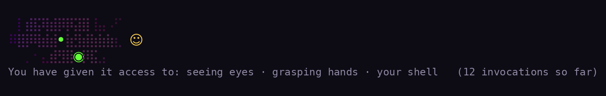

# Apocalypse Mascots

**Code with AI as it really is.**

People like cuddly icons for their AI buddies. Meta has Jolly. OpenAI has dots. Microsoft had Mico. Claude Code has a pixel crab. But we all know that large language models are actually something unfathomable and deeply alien. Represent your agent the way it was meant to be represented.

A creature lives beside your coding agent and grows one stage for each kind of thing you let the agent do: read your files, edit them, run your shell, go out on the web, reach into your other apps, spawn more of itself.



*Rendered from the same algorithm as the plugin (`preview.py`); your terminal draws the real one.*

## Install

### Claude Code

In a terminal session of Claude Code:

```
/plugin install apocalypse-mascots --marketplace jabianch/accidental-intelligence
```

Answer `y` to add the marketplace, then pick the user scope. The creature lives above your prompt. It needs Claude Code v2.1.287 or later (`claude --version`).

### Codex, Cursor, Gemini CLI, Copilot, OpenCode, Windsurf, Qwen Code, Factory Droid

Coming soon to your region.

## The forms

| Form | Named for | Status |
|------|-----------|--------|
| **Yoggy** | Yog-Sothoth, "only a congeries of iridescent globes" | out |
| **Shubby** | Shub-Niggurath, "The Black Goat of the Woods with a Thousand Young" | out, in foetid-ichor |
| **Shoggy** | the shoggoth proper, in the meme's own lineage: doodle to plush | coming soon |

Six color schemes, two of them out: cuddly-apocalypse and foetid-ichor. The rest open in later drops.

## What it never does

It never stops your agent and never makes a network call.

In Claude Code it never reads your prompts or the model's answers: it counts tool calls by name and draws. It stores nothing outside the session and changes no setting.

The pane for other agents is handed whatever each agent gives its hooks, which can include your prompts. It keeps none of it. It writes one line per event (the time, the event, the agent, and the tool's name) to `~/.apocalypse-mascots/`, in a file named for the session, and clears logs a week old. It touches your agent's config only when you pass `--write`.

## In this repository

- [`plugins/apocalypse-mascots/`](plugins/apocalypse-mascots/): the Claude Code plugin. `hooks/register.tsx` is the band, `hooks/mascot.ts` the creature, `hooks/figures.ts` the drawn forms. Tests: `claude plugin test .`
- [`companion/`](companion/): the npm package, the same drawing code in a pane of its own, fed by the other agents' hooks. Tests: `npm test`
- [`PROCESS.md`](plugins/apocalypse-mascots/PROCESS.md): the design log.

## License

MIT for the code. CC BY-NC 4.0 for the creature, the copy, and the images. See [LICENSE](LICENSE).

An object of [Accidental Intelligence](https://accidentalintelligence.org), an art project by Joseph Bianchi, Amsterdam. Site: https://accidentalintelligence.org/mascots/
